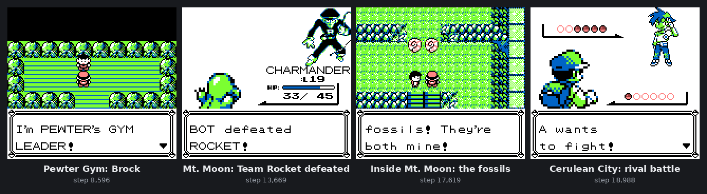
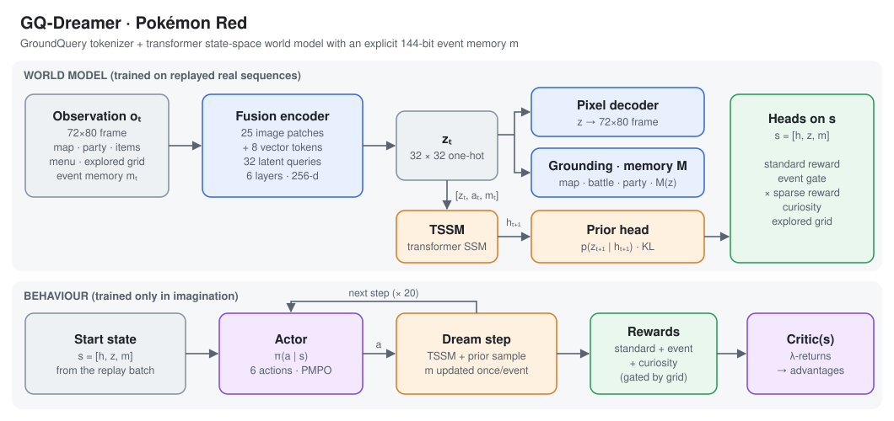
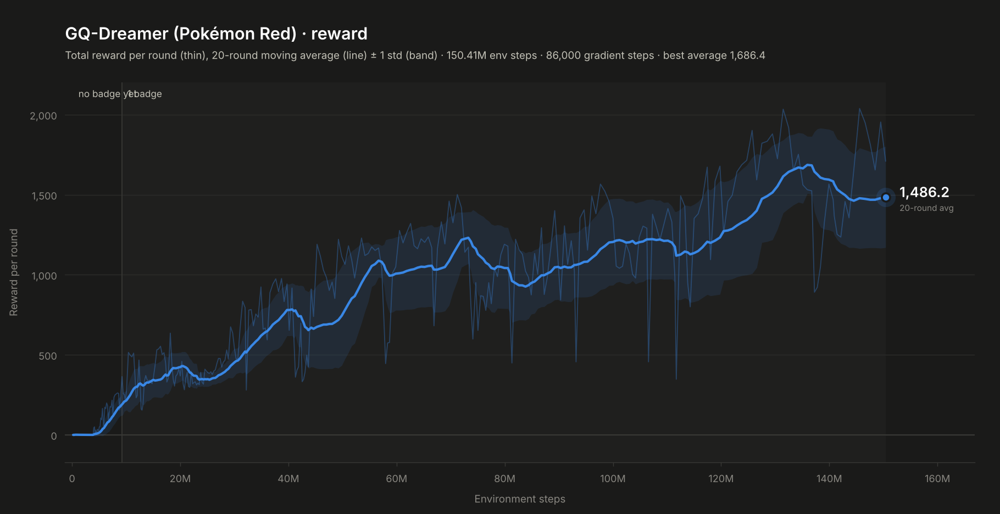

<div align="center">

# GQ-Dreamer · Pokémon Red

**A model-based reinforcement-learning agent that learns to play Pokémon Red inside its own learned world model, with an explicit memory of the story events it has completed.**



*Moments from one of the last training episodes (110,000 agent steps, 40 events completed): the agent wins the
Boulder Badge from Brock, defeats Team Rocket and reaches the fossils in Mt. Moon, then faces its rival in Cerulean
City. The frames were re-rendered at full resolution by replaying the episode's recorded actions in the emulator.*

</div>

---

## Overview

GQ-Dreamer (**GroundQuery-Dreamer**) is a new world-model agent of the Dreamer family. Pokémon Red is a much longer game than an arcade level:
progress depends on events far in the past (talking to Oak, delivering the parcel, beating a trainer), which a
world model has to remember. GQ-Dreamer handles this with three components:

- **GroundQuery tokenizer.** A fusion transformer reads the screen as 25 patch tokens *together with* 8 game-state
  tokens (map and position, party, opponent, items, menu, explored grid, event memory). **32 learned latent queries**
  read the fused tokens and output a 32 × 32 one-hot latent `z`. A pixel decoder and grounding heads read `z` only.
- **Explicit event memory `m`.** 144 bits (134 story flags, 2 milestones — the first Poké Ball and the Brock battle — and the 8 badges) are part of the agent
  state `s = [h, z, m]`. A memory head `M(z)` learns to read the memory from the latent, and in dreams an **event gate**
  decides when a new bit turns on, so each imagined event is paid at most once.
- **Transformer state-space model (TSSM).** A causal transformer with RoPE, gated attention, an attention sink and a KV
  ring cache predicts the next latent from `[z_t, a_t, m_t]`.

The policy is trained only on **imagined rollouts** ("dreams") of the world model that start from replayed states.

<p align="center"></p>

## Results

Trained for **85,500 gradient steps / 149.5 M environment steps** (3,440 episodes, 10 emulators in parallel) on a
single GPU. The model has ~78 M parameters.

<p align="center"></p>

| At the end of training (last 20 rounds) | |
|---|---|
| Episode reward (20-round average) | **≈ 1,490** (best episode ≈ 2,040) |
| Story events completed per episode | **≈ 27** on average, up to 39 |
| Maps visited per episode | ≈ 22 |
| Boulder Badge (Brock) | earned by at least one episode in 39 of the last 40 rounds |

## How it works

**Observation.** Every agent step lasts 24 emulator frames (400 ms). The agent sees the screen reduced to 72 × 80, the
5 × 5 grid of squares around the player visited in this episode, and RAM values: map and position, battle and menu
state, party, opponent, items, badges and the event memory. There are 6 actions (arrows, A, B).

**World model.** For every replayed sequence the encoder produces `z_t`; the pixel decoder, grounding heads and memory
head reconstruct the frame, the game state and `m_t` from `z_t`; the TSSM reads `[z_t, a_t, m_t]` and the prior head
predicts `z_{t+1}` (balanced KL). Heads on `s = [h, z, m]` predict the standard reward, the curiosity, the explored grid,
the **event gate** (does a new memory bit turn on in this transition?) and the **sparse reward** of that event.

**Behaviour.** Dreams of 20 steps start from replayed states. A dream step pays the predicted standard reward + the
sparse reward × P(event); when the gate fires, the bits that `M(z)` reports and `m` does not yet hold are set, so the
same event never pays twice. The actor is trained with **PMPO** on the sign of each reward stream's advantage, with an
entropy bonus and a KL to a slowly moving copy of itself; the critics use HL-Gauss targets.

**Rewards.**
- +50 for every new memory bit (story event, key milestone, badge); each also extends the episode by 2,500 steps.
- Level-ups and healing the party pay a small standard reward.
- Curiosity: every new square pays its map's value, scaled by how rarely earlier episodes stood there (cross-episode
  novelty), with a bonus for the first square of a new map.

Death is not modelled: a blackout sends the player back to the most recent town with a Pokémon Center and the episode goes on.

## Quick start

### 1. Install

```bash
git clone https://github.com/SeleucusTheGreat/GQ-Dreamer-PokemonRed.git
cd GQ-Dreamer-PokemonRed
git lfs install && git lfs pull        # downloads model/model.pt (≈ 345 MB)

conda create -n gqdreamer python=3.11 && conda activate gqdreamer
pip install torch --index-url https://download.pytorch.org/whl/cu124   # CUDA build (CPU works for playing)
pip install -r requirements.txt
```

### 2. Add the game

The ROM is not included. Copy your own dump of **Pokémon Red** to `game/PokemonRed.gb`. The start state
`game/PokemonRed.Start.state` (just after receiving the Pokédex) is included.

### 3. Watch the trained agent

Open **`run.ipynb`** and run the cell: the model in `model/model.pt` plays in an emulator window. Or from Python:

```python
from gq_dreamer import run
run(mode="eval", checkpoint="model/model.pt", max_steps=3000, verbose=True, recording=True)
```

`verbose=True` prints every map entered and every event completed; `recording=True` saves
`recordings/eval_agent1.mp4`; `window=False` runs headless. A full episode is 10,000+ agent steps.

### 4. Train

Open **`main.ipynb`**, or:

```python
from gq_dreamer import run
run(mode="train", num_envs=10)
```

Training resumes from the newest checkpoint in `checkpoints/` and writes metrics to `metrics/training_data.csv`,
reward plots and exploration maps to `plots/`. Every hyperparameter is a field of `GQDreamerConfig` in
`gq_dreamer/config.py` and can be overridden: `run(..., curiosity_scale=0.5)`. Training needs a CUDA GPU.

## Repository layout

```
gq_dreamer/
  model.py             every network: latents, heads, actor / critic, tokenizer + memory head, TSSM, prior
  gq_dreamer.py        the agent: world-model update, dream events, imagination, acting, dream audit
  env.py               PyBoy environment, rewards, novelty, parallel emulators
  game.py              game constants: maps, events, memory layout, RAM addresses
  observations.py      frame processing, patches, side inputs
  replay.py            replay buffer and batch prefetcher
  trainer.py           training loop, evaluation, metrics, run()
  config.py            GQDreamerConfig: all hyperparameters
  audit.py             dream audit (dreamed vs real rollouts)
  checkpoint.py        saving / loading
  plots.py, visualize.py, dream_render.py, exploration_maps.py, train_utils.py
model/model.pt         the trained agent (Git LFS)
game/                  start state (add the ROM here)
metrics/               training curves (CSV)
main.ipynb             training
run.ipynb              play the trained model
```

## Related work

GQ-Dreamer is a new model of the Dreamer family of world-model agents, alongside
[DreamerV3](https://arxiv.org/abs/2301.04104) and transformer world models such as
[TWM](https://arxiv.org/abs/2303.07109), [IRIS](https://arxiv.org/abs/2209.00588) and
[STORM](https://arxiv.org/abs/2310.09615): it learns a model of the environment and trains its policy in imagination.
It uses HL-Gauss value targets ([Farebrother et al., 2024](https://arxiv.org/abs/2403.03950)), the
[PyBoy](https://github.com/Baekalfen/PyBoy) emulator and the RAM map of the [pret/pokered](https://github.com/pret/pokered)
disassembly. Pokémon Red is © Nintendo / Game Freak; this repository contains no game data.
